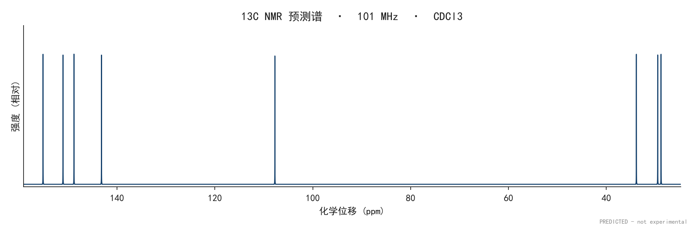

# nmrflow

[中文](README.md) | English

**SMILES in, predicted NMR spectra and literature-style reports out.**

- **Always produced:** ¹H and ¹³C NMR
- **Auto-detected:** ¹⁹F if the SMILES contains fluorine; ³¹P if it contains phosphorus
- **Reported values:** `SMILES:1H NMR (CDCl3, 400 MHz) δ: ... 13C NMR ... HRMS (DART) for CxHy... m/z: Calculated, ... [M+H]+.`
  (only `Calculated`; no fabricated `Found` values)
- **Designed for new compounds:** no experimental-database lookup is required. The
  prediction combines empirical rules, environment lookup tables, HOSE, and a
  spin Hamiltonian for second-order effects.

## 1. Scope and responsible use

nmrflow returns **predictions**, not experimental data. The default output has no
`Found` value and no simulated-Found option.

Use it for experiment planning, assignment support, teaching, and method comparison.
**Do not** present its spectra or HRMS values as measured data, and do not remove the
`PREDICTED` watermark, the `report.txt` footer, or the provenance in `manifest.json`
before treating an output as if it were experimental. See [ETHICS.md](ETHICS.md).



*Predicted ¹³C spectrum of caffeine. The lower-right watermark says
`PREDICTED - not experimental`; the PNG metadata also contains `Software` and
`Description`.*

---

## 2. Version changes (0.3.0 → 0.3.4)

Current source version: **0.3.4**. Only user-visible changes since 0.3.0 are listed
here; 0.2.x history is in [CHANGELOG.md](CHANGELOG.md).

| Version | Change | Effect |
|---|---|---|
| 0.3.0 | Simulated `Found` removed | HRMS reports `Calculated` only; `--found`, `--no-found`, `--seed`, `RunOptions(ms_found_mode=...)`, and `found_is_simulated` were removed |
| 0.3.0 | Output guardrails | `report.txt` ends with `Predicted by nmrflow ... - not experimental data.`; PNGs carry a `PREDICTED` watermark and `Software`/`Description` metadata; every run writes `manifest.json` |
| 0.3.1 | Install/test/line-ending fixes | `pip install .` no longer installs an empty package; `pytest` works from a clean clone; source-archive `.bat` files are locked to CRLF |
| 0.3.2 | ¹⁹F haloethane environments | Six both-carbon halogen environments; CF₂ next to a stereocenter raises a possible-AB warning; the 265-test development suite was added to the repository |
| 0.3.3 | P1/P2 delivery work | CLI partial-failure return code, >10-spin warning, `M⁺·`, ZIP payload, bat generator/uninstall safety/stop-bat checks, CI actions |
| 0.3.4 | Sulfonyl fluoride refinement | `CF3-SO2F` and triflate are separate; `R-SO2F` is split into CH₃/CH/CF₂; SO₂F₂, FSO₃H, FSO₃F (S-F/O-F), and R-O-SO₂F are separate; ¹H CH₂ diastereotopic warning; curated-override diagnostic |

Tests: **283** repository tests in 16 modules, plus **36** delivery tests in the
portable package (`tests/run_tests.py`). See §8.

## 3. Installation

Python **3.13** is required.

```bash
python -m venv .venv
# Windows: .venv\Scripts\activate
# Linux/macOS: source .venv/bin/activate

pip install -r requirements.txt
# or: pip install -e ".[web]"

pip install -r requirements-dev.txt   # tests only
```

Runtime dependencies: `rdkit`, `numpy`, `scipy`, `matplotlib`, `pandas`.
The web UI additionally needs `streamlit` (`pip install -e ".[web]"`).

For normal use on Windows, download the portable ZIP from
[GitHub Releases](https://github.com/Leak2/nmrflow-predictors/releases), unzip it,
and double-click `NMR-Predictor.exe` (or `启动 NMR.bat`). It is self-contained:
no Python installation, network access, or administrator rights are required.

## 4. Usage

### Command line

```bash
# One molecule
python -m nmrflow.cli "CCO" -o results

# Solvent and field strength (60 MHz makes second-order effects obvious)
python -m nmrflow.cli "CCOC(C)=O" --solvent DMSO-d6 --mhz 60

# Batch mode (one SMILES per line; text after # is a comment)
python -m nmrflow.cli -f examples/smiles.txt -o results

# Tier A only: disable HOSE database correction
python -m nmrflow.cli "Cn1cnc2c1c(=O)n(C)c(=O)n2C" --no-tier-b
```

Outputs in `-o results`:

| File | Content |
|---|---|
| `<name>_1H.png` | ¹H spectrum with integral curve, peak-top δ labels, and residual solvent peak |
| `<name>_13C.png` | ¹³C spectrum |
| `<name>_19F.png` / `<name>_31P.png` | Only when the molecule contains F / P |
| `<name>_MS.png` | Isotope-pattern bar chart |
| `<name>_report.txt` | Literature-style text report, including HRMS |
| `<name>.json` | Full intermediate state with `--json` (signals, couplings, provenance) |
| `manifest.json` | Input, options, output versions, and SHA-256; written on every run |

### Python API

```python
from nmrflow.pipeline import run, RunOptions

result = run("FC(F)(F)c1ccccc1", RunOptions(solvent="CDCl3", proton_mhz=400))
print(result.report.text)

for nucleus, spec in result.spectra.items():
    print(nucleus, spec.x_ppm.shape, spec.freq_mhz)
```

### Web UI

```bash
streamlit run nmrflow/app.py
```

Enter a SMILES, solvent, and field strength in the left column; spectra and the
report appear in the right column. The report and ZIP of all results can be
downloaded directly.

The portable Windows launcher starts Streamlit, waits for the port, and opens
`http://127.0.0.1:8901`. Closing the launcher stops the service.

## 5. Example output

```text
CCO:1H NMR (CDCl3, 400 MHz) δ: 3.47-3.53 (q, J= 7.0 Hz, 2H, -CH2-), 2.20 (br s, 1H, -OH),
1.20-1.24 (t, J= 7.0 Hz, 3H, -CH3).13C NMR (CDCl3, 101 MHz) δ: 57.80, 16.80.
HRMS (DART) for C2H6O m/z: Calculated, 47.0491 [M+H]+.
```

The report ends with:

```text
Predicted by nmrflow 0.3.4 - not experimental data.
```

## 6. How prediction works

1. **Structure preparation** — RDKit standardizes the molecule, removes salts, and
   builds the heavy-atom graph.
2. **Tier A empirical rules** — ¹H and ¹³C additivity rules; ¹⁹F/³¹P use SMARTS-based
   environment tables.
3. **Tier B HOSE lookup** — HOSE codes are built from a SQLite index derived from
   NMRShiftDB2 experimental spectra. Shallow hits can be refused by pinned table
   entries; ¹H/¹³C/¹⁹F/³¹P have separate confidence handling.
4. **Spin Hamiltonian** — coupled spins are diagonalized exactly up to a configurable
   limit, producing second-order multiplets and realistic intensities. Larger systems
   fall back to first-order multiplets with an explicit warning.
5. **Reporting and plotting** — spectra, peak lists, a literature-style text report,
   PNG metadata, and JSON provenance are written together.

### ¹⁹F and ³¹P

The heteronuclear tables map SMARTS environments to shifts rather than using
additivity. The 0.3.4 tables include:

- CF₃, CF₂, CHF, Ar-F, and sulfonyl fluoride environments;
- six 1,2-dihalo-1,2-difluoroethane environments with `protect = true`;
- `CF3-SO2F`, triflate, `R-SO2F` CH₃/CH/CF₂ subclasses;
- SO₂F₂, FSO₃H, FSO₃F (S-F and O-F), and R-O-SO₂F.

Known limitation: CF₂ groups next to a potential stereocenter are reported as a
single 2F line with an explicit "possible AB" warning. AB splitting and ²J(F,F)
are not implemented.

## 7. Accuracy and limitations

- **¹H:** typically within ±0.3 ppm; most cases are below ±0.15 ppm.
- **¹³C:** empirical rules plus HOSE correction; second-order effects are handled by
  the spin Hamiltonian.
- **¹⁹F/³¹P:** environment-table values take priority over very shallow HOSE hits.
  Global ¹⁹F MAE was not re-derived for every table change; treat unusual environments
  as `low` confidence and check the provenance.
- **Solvent:** the HOSE index is largely solvent-blind; most NMRShiftDB2 records do
  not carry a solvent label.
- **Scope:** 1D ¹H/¹³C/¹⁹F/³¹P only; no 2D NMR, NOE, or quantitative relaxation.
- The Windows executable is unsigned; SmartScreen may warn. Verify SHA-256 values
  or use `启动 NMR.bat`.

## 8. Tests

```bash
python -m pytest tests/ -q
```

- Repository: **283 tests** in 16 modules, including Streamlit AppTest and packaging
  tests.
- Portable package: **36** stdlib `unittest` delivery tests (`tests/run_tests.py`);
  the portable runtime does not include pytest.

## 9. Data and HOSE index

The bundled HOSE index (`app/nmrflow/data/hose_index.sqlite`, about 32 MB) is derived
from NMRShiftDB2 experimental spectra.

Current source data:

```text
nmrshiftdb2withsignals.sd
size       158,569,118 B
raw records 58,187
with signals 56,786
```

The index contains 328,991 rows:
¹H 77,188 codes / 140,434 shifts; ¹³C 238,295 / 481,139;
¹⁹F 1,727 / 5,833; ³¹P 11,781 / 13,412.

Rebuild:

```bash
python tools/build_hose_index.py --sd /path/to/nmrshiftdb2withsignals.sd \
  --out app/nmrflow/data/hose_index.sqlite
```

The index is a derivative database under the **nmrshiftdb2 Database License**.
The license text and attribution are shipped as
`app/nmrflow/data/nmrshiftdb2_database_license.txt` and
`app/nmrflow/data/HOSE_INDEX_NOTICE.txt`.

## 10. Repository layout

```text
nmrflow/
├─ app/
│  ├─ nmrflow/                 core package (predict, spin, plot, report, GUI)
│  ├─ nmrflow/data/            tables, HOSE index, license notices
│  ├─ tools/                   evaluation and diagnostic tools
│  └─ build/                   training indexes used by evaluation
├─ tests/                      283 pytest tests
├─ packaging/bat/              Windows bat templates
├─ assets/, examples/
├─ README.md, README-EN.md
├─ CHANGELOG.md, REPRODUCE.md, ETHICS.md
├─ CITATION.cff, .zenodo.json
└─ pyproject.toml
```

## 11. License

- **Code:** BSD-3-Clause. See [LICENSE](LICENSE).
- **HOSE index / NMRShiftDB2-derived data:** nmrshiftdb2 Database License. See
  `app/nmrflow/data/nmrshiftdb2_database_license.txt` and
  `app/nmrflow/data/HOSE_INDEX_NOTICE.txt`.
- The two licenses are different; do not describe the whole repository as BSD-3-Clause
  without the data-license notice.

## 12. Citation

Use [CITATION.cff](CITATION.cff).

- Version DOI (0.3.4): <https://doi.org/10.5281/zenodo.24199403>
- Concept DOI (all versions): <https://doi.org/10.5281/zenodo.23923954>

[](https://doi.org/10.5281/zenodo.24199403)

If you use nmrflow in academic work, cite the software and the exact version.
