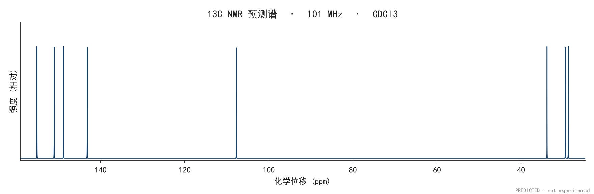

# nmrflow

输入一个 **SMILES**，输出 **NMR 谱图 PNG + 文献风格报道值 + HRMS 预测**。

- **必出**：¹H NMR、¹³C NMR
- **自动检测**：SMILES 里含 F 就追加 ¹⁹F NMR；含 P 就追加 ³¹P NMR
- **报道值**：`SMILES:1H NMR (CDCl3, 400 MHz) δ: ... 13C NMR ... HRMS (DART) for CxHy... m/z: Calculated, ... [M+H]+.`
  （默认只给 Calculated，不伪造实测值）
- 面向**新化合物**：不依赖实验库检索，纯结构推演（经验加和 + 环境查表 + 自旋哈密顿量）

## 使用边界（先读）

nmrflow 输出的是**预测**，不是实验数据；默认只给 `Calculated`，没有 `Found`，也没有模拟 Found 开关。
可以拿它做实验设计、谱图指认、教学和方法比较；**不要**把预测谱/预测 HRMS 写成实测值，也不要移除
`PREDICTED` 水印、`report.txt` 页脚或 `manifest.json` 后当实验数据使用。完整说明见
[ETHICS.md](ETHICS.md)。



*示例：咖啡因 ¹³C 预测谱；右下角 `PREDICTED - not experimental` 是默认水印，PNG metadata 里也有 `Software` / `Description`。*

---

## 0. 版本与行为变更（0.2.2 → 0.3.2）

当前源码版本 **0.3.2**。0.2.2–0.2.4 最初只做在便携包里（外部评审后的修复），0.2.5 把它们**回灌进源码仓库**，
并修掉回灌带进来的一个回归；0.2.6 撤掉小双环特例，0.2.7 让评估套件随包、exe 带上版本资源，
0.2.8 吸收了外部交付里的界面/脚本改进（自动停止、卸载向导、自检），但**驳回了**其中
「恢复小双环守卫」的改动（依据是错的，见 §8.5）；0.2.9 修掉 0.2.8 交付物里的两个坑
（全部 bat 是 LF-only、自检在 GBK 控制台崩溃），并给打包加了字节级检查。逐项见 `CHANGELOG.md`。

用户能感知的变化（升级前请扫一眼）：

| 变化 | 影响 |
|---|---|
| **模拟 Found 已删除** | 默认 HRMS 只有 `Calculated`；0.2.9 起已删除 `--found`、`--no-found`、`--seed` 与 `RunOptions(ms_found_mode="simulate")`，不再提供任何模拟 Found。所有 `report.txt` 末尾带 `Predicted by nmrflow ... - not experimental data.` |
| **GUI 落盘 `results/`** | 谱图、报道值、`manifest.json` 写到 `results/<SMILES>/`，并给下载按钮；新增「下载全部结果（ZIP）」 |
| **GUI 批量模式** | 每行一个 SMILES，最多 30 个，单个失败不中断；结果在 `results/batch_时间戳/` |
| **结构式预览** | 单分子结果显示 RDKit 2D 结构，便于发现 SMILES 输错 |
| **`停止 NMR.bat`** | 结束监听 8901 的进程（原来只能去任务管理器）；0.2.8 加重写：带端口参数、`/quiet`、复查端口是否释放 |
| **关闭页面后自动停止（0.2.8）** | 侧栏可勾选，所有页面关掉 3 分钟后自动退出；默认关闭，刷新/切标签/休眠不会误停 |
| **卸载向导（0.2.8）** | `卸载.bat` 三选一：只删快捷方式 / 连目录一起删（先把 `results` 移到桌面）；服务停不掉就中止删除 |
| **`自检.bat`（0.2.8）** | 双击核对随包的评估脚本、三份索引与哈希、训练索引是否真的排除了留出集 |
| **带电物种 HRMS** | 乙酸根 `[M]⁻ 59.0139`、四甲基铵 `[M]⁺ 74.0964`；Na⁺/Cl⁻ 不再出 HRMS |
| **低置信度 ¹H 不再被 12 Hz 展宽** | 乙醇 CH₂ 能看到 4 条线，不再与「q, J=7.0」的文字自相矛盾 |
| **与 Tier A 分歧只提示、不降级** | 咖啡因 ¹³C、胆固醇 ¹³C 不再出现「预测越对、置信度越低」 |
| **³¹P 默认保护 curated 表项** | 磷酸三甲酯 ³¹P 从 14.35 回到 0.0（实测 ≈2.7）；整体 MAE 19.45 → 19.49 |
| ~~十氢萘/降冰片烷走规则而非 HOSE~~ | **0.2.6 撤销**：那三个常数照错了参考值标定（见下），放开 HOSE 后十氢萘 42.5/32.6/25.9 对实测 44.2/34.7/27.1，误差从 9.5 降到 2.1 |

0.2.5 修掉的那个回归：`exact_transitions` 的耦合预算曾用全局 `Σ|J|/2`，把 AX / AB 体系
的四条线砍成两条（强度又被重新归一化，总积分看着正常）。现在改为每个自旋自己的 `Σ|J|`，
并把强度归一化移到所有过滤之后。`tests/test_spin.py` 有 AX 与 AB 两条回归钉住。

测试：仓库 `pytest tests/` 共 **265 条**（16 个模块，含 `test_app.py`）；便携包内
`tests/run_tests.py` 是 **36 条**交付级 stdlib unittest。详见 §7。

## 1. 安装

```bash
python -m venv .venv && .venv/Scripts/activate      # Windows
pip install -r requirements.txt                     # 运行时依赖；或用 pip install -e ".[web]"
pip install -r requirements-dev.txt                 # 只有跑测试才需要（pytest）
```

依赖：`rdkit`（结构）、`numpy` / `scipy`（对角化）、`matplotlib`（出图）。  
Web 界面另需 `streamlit`（`pip install -e ".[web]"`）；测试需要 `pytest`，
已与运行时分家（`requirements-dev.txt` / `[dev]` 额外），便携包 runtime 里不再带它。

## 2. 用法

### 命令行

```bash
# 单个分子
python -m nmrflow.cli "CCO" -o results

# 指定溶剂与场强（60 MHz 会看到明显的二级谱效应）
python -m nmrflow.cli "CCOC(C)=O" --solvent DMSO-d6 --mhz 60

# 批量（每行一个 SMILES，# 后为注释）
python -m nmrflow.cli -f examples/smiles.txt -o results

# 只用经验规则、不做 HOSE 数据库校正（想知道"纯规则"会给什么值时）
python -m nmrflow.cli "Cn1cnc2c1c(=O)n(C)c(=O)n2C" --no-tier-b
```

产出（`-o results`）：

| 文件                            | 内容                                |
| ----------------------------- | --------------------------------- |
| `<名>_1H.png`                  | ¹H 谱（含积分曲线、峰顶 δ 标注、残余溶剂峰）         |
| `<名>_13C.png`                 | ¹³C 谱                             |
| `<名>_19F.png` / `<名>_31P.png` | 仅当分子含 F / P 时生成                   |
| `<名>_MS.png`                  | 同位素分布棒图                           |
| `<名>_report.txt`              | 报道值文本（含 HRMS）                     |
| `<名>.json`                    | `--json` 时 dump 全部中间态（信号、耦合、开箱可查） |
| `manifest.json`               | 输入/选项/输出版本与 SHA256；每次运行都写 |

### Python API

```python
from nmrflow.pipeline import run, RunOptions

result = run("FC(F)(F)c1ccccc1", RunOptions(solvent="CDCl3", proton_mhz=400))
print(result.report.text)
for nucleus, spec in result.spectra.items():
    print(nucleus, spec.x_ppm.shape, spec.freq_mhz)
```

### Web 界面

```bash
streamlit run nmrflow/app.py
```

左栏输入 SMILES / 溶剂 / 场强，右栏实时出图，报道值可一键下载。
「示例分子」默认是「（自定义）」，输入框留空；选一个示例会把它的 SMILES
填进输入框，之后仍可继续改。

生成结果常驻会话：点下载、改参数、点「打开结果目录」都不会让页面退回空状态，
可以逐个下载需要的谱图。结果区顶部会标明这一屏属于哪个分子、哪次生成，
并给一个「清空结果」按钮。

**日常使用请直接双击桌面上的「NMR 谱图预测」快捷方式**（或在项目根目录双击 `launch-nmr.bat`）。  
启动器会自己找可用的 Python、跳过已运行的实例（只在浏览器里重新打开页面），  
并托管 `http://127.0.0.1:8901`。窗口最小化在任务栏，关掉它即停止服务。

快捷方式指向 `launch-nmr.bat`，图标来自 `assets/nmr.ico`（由 `tools/make_icon.py` 生成）。  
换电脑或移动项目目录后，重新执行一次：

```bash
python tools/make_icon.py     # 需要时才重画图标
```

再按同样参数重建快捷方式即可（目标填 `launch-nmr.bat` 的绝对路径，起始位置填项目根目录）。

> 新机器上首次跑 Streamlit 若卡在 “Welcome to Streamlit! … Email:” 提示，  
> 建 `~/.streamlit/credentials.toml`，内容两行 `[general]` 和 `email = ""` 即可跳过。

启动器还会把控制台切到 UTF-8 并打开 ANSI 转义处理（`tools/win_ansi.py` 对当前窗口设置  
`ENABLE_VIRTUAL_TERMINAL_PROCESSING`，不写注册表）。少了这一步，Streamlit 的彩色提示会在  
cmd 里变成一串 `[0m` `[34m` 方块——Win10 的 conhost 默认不解释 VT 序列。

### 开发用的虚拟环境

测试跑在 `.venv-test` 里，它的底座是 **`build/runtime/python`**，不依赖任何 `dist/` 产物。
重建方式：

```bash
build/runtime/python/python.exe -m venv --system-site-packages .venv-test
.venv-test/Scripts/python.exe -m pip install pytest
.venv-test/Scripts/python.exe -m pytest tests/ -q
```

`--system-site-packages` 是关键：rdkit / numpy / scipy / matplotlib / streamlit 直接从
runtime 借用，不必重装约 200 MB 依赖。代价是这个 venv **依赖 `build/runtime` 存在**——
删了 `build/` 就得先跑 `tools/build_runtime.py` 重建（约 6 分钟）。

> 这里踩过一次：早先 `.venv-test/pyvenv.cfg` 的 `home` 指向
> `dist/nmrflow-0.1.0-portable/runtime/python`，等于把开发环境挂在一个**发布产物**上。
> 结果是"删掉旧便携包"就会让开发环境失效，而这件事在删之前完全看不出来。
> 现在指向 `build/runtime`，`dist/` 里的包怎么清都不影响开发。

### 发布便携包（拷到别的电脑上用）

目标机器不需要装 Python、不需要联网、不需要管理员权限：

```bash
python tools/build_runtime.py     # 造一份可重定位的 CPython 并装好全部依赖
python tools/make_release.py      # 组装 + 冻结 exe + 打 zip
```

产物在 `dist/`：

```
nmrflow-0.3.2-portable/
├─ NMR-Predictor.exe      双击启动（无控制台窗口）
├─ 启动 NMR.bat           命令行版，排错时能看到 Streamlit 原始输出
├─ 安装.bat / 卸载.bat    桌面快捷方式的增删
├─ 安装使用说明.txt        给最终用户的三步上手说明
├─ app/                   源码
│  ├─ nmrflow/data/hose_index.sqlite   HOSE 索引（32 MB，Tier B 靠它）
│  ├─ tools/              评估套件：复算 §5 的留出法数字（12 个文件）
│  └─ build/              两份训练索引（27 MB），评估用，运行时不读
├─ runtime/python/        内置 CPython 3.13 + rdkit / streamlit / numpy …
├─ assets/ examples/ results/ logs/
└─ README.md
```

要点：

- `runtime/home` 充当隔离的 `HOME`，Steamit 的首次邮箱提示被提前写好的  
  `credentials.toml` 挡掉，也不会污染用户的真实 Profile。
- exe 由 PyInstaller 冻结 `tools/launcher.py`（只依赖标准库 + pylnk3），  
  负责拉起 Streamlit、等端口就绪、开浏览器，并在首次运行时询问是否建桌面快捷方式。
- 想换成离线 wheel，把 `build_runtime.py` 里的安装命令改成  
  `pip install --no-index --find-links wheels/ ...` 即可（其余流程不变）。
- **HOSE 索引随包发布**。它不在 `build/` 里由运行时生成，而是随源码一起进
  `app/nmrflow/data/`；文件名固定为 `hose_index.sqlite`，`resolve_index_path()`
  按「显式传入 → 包内 → 开发期 build/」的顺序查找。缺了它程序仍能跑，
  但 Tier B 会静默跳过——界面上的「HOSE 数据库校正」勾选框会自动变为不勾选。
  索引是 NMRShiftDB2 的衍生数据，按许可要求必须同时带上
  `nmrshiftdb2_database_license.txt` 与 `HOSE_INDEX_NOTICE.txt`。
- `make_release.py` 结束前会跑 `check_layout()`：主程序、几个 bat、索引、
  `runtime/python/python.exe`、rdkit/streamlit 任一缺失就报错退出。
  换版本号后 `dist/<新版本>` 是空目录，没有这道检查很容易打出"双击没反应"的包。
- **exe 带版本资源（0.2.7 起）**。`tools/version_info.py` 从 `nmrflow/__init__.py`
  读 `__version__`（单一口径）生成 PyInstaller 的 `--version-file`，属性页能看到
  `FileVersion / ProductName / FileDescription / LegalCopyright`；打包后用 `pefile`
  把资源读回来比对。`--skip-exe` 回收旧 exe 时也核对版本号——否则会出现
  "包名是新版、属性页写旧版"，比没有版本号更糟。
  注意 `--version-file` 与 `--icon` 的路径是**相对 `--specpath`** 解析的。
- `build_runtime.py` 最后会把 `Lib/` 与 `site-packages/` 用  
  `--invalidation-mode unchecked-hash` 预编译成 `.pyc` 一起打包。  
  这既省掉首次运行的编译开销，也避开了一个真实踩到的坑：  
  首次启动时有多个线程抢着生成同一个 `.pyc`，其中一个线程读到写了一半的文件，  
  表现为 numpy 抛 `missing ), unterminated subpattern`（`numpy.f2py` 的正则常量被截断）。  
  运行时另设 `PYTHONDONTWRITEBYTECODE=1`，彻底不再写字节码。
- 打包后自检：
  ```bash
  python tools/verify_package.py <解压后的目录>
  ```
  它会启动 exe、用 websocket 建立一次真实的 Streamlit 会话（只有真正的会话才会  
  执行 app 脚本），再检查 `logs/streamlit.log` 里有没有异常堆栈。

---

## 3. 输出长什么样

```
CCO:1H NMR (CDCl3, 400 MHz) δ: 3.47-3.53 (q, J= 7.0 Hz, 2H, -CH2-), 2.20 (br s, 1H, -OH),
1.20-1.24 (t, J= 7.0 Hz, 3H, -CH3).13C NMR (CDCl3, 101 MHz) δ: 57.80, 16.80.
HRMS (DART) for C2H6O m/z: Calculated, 47.0491 [M+H]+.
```

```
FC(F)(F)c1ccccc1:1H NMR (CDCl3, 400 MHz) δ: 7.51-7.77 (m, J= 7.7 Hz, J= 1.6 Hz, 2H, Ph-H),
7.15-7.51 (m, 3H, Ph-H).19F NMR (CDCl3, 376 MHz) δ: -63.00 (s, 3F).
13C NMR (CDCl3, 101 MHz) δ: 131.60 (q JC-F= 0.6 Hz, Ph-C), 131.10 (q JC-F= 32.0 Hz, Ph-C),
128.90 (q JC-F= 1.4 Hz, Ph-C), 125.30 (q JC-F= 3.7 Hz, Ph-C), 125.00 (q JC-F= 272.6 Hz, -CF3).
HRMS (DART) for C7H5F3 m/z: Calculated, 147.0416 [M+H]+.
```

排版约定：

- **¹H** 写 δ 区间（`7.80-7.86 (m, 4H, Ph-H)`），因为一个多重峰的谱线本来就散在一段区间里；
- **¹³C / ¹⁹F / ³¹P** 写**中心值 + 多重度 + J**（`124.04 (q, JC-F = 272.6 Hz, -CF3)`），与文献一致；
- 默认只给 `Calculated`。0.2.9 起已删除模拟 Found（`--found` / `ms_found_mode="simulate"`），不会生成 `Found`。所有 `report.txt` 末尾带 `Predicted by nmrflow ... - not experimental data.`，PNG 带 `PREDICTED - not experimental` 水印与 `Software`/`Description` 元数据。

---

## 4. 谱图是怎么算出来的

```
SMILES
  │  rdkit 解析 / 去盐 / 加显式氢
  ▼
等价性划分  symmetry_classes + 非对映异位 CH₂ 检测
  │        → 每个核种一组 Signal（含积分 = 核数）
  ▼
化学位移预测（三层可插拔）
  │  Tier A 经验加和 + 环境查表（始终在线）
  │  Tier B HOSE 球形环境码查表（默认开启）
  │  Tier C ML 插件位（预留接口）
  ▼
耦合常数预测
  │  ¹H-¹H：键路径 + 环内距离 + Karplus 表
  │  ¹H/¹³C/¹⁹F/³¹P 异核：按"几根键"查表 + SMARTS 环境覆盖
  ▼
自旋体系分块  Δν/J（**按 Hz 算**，随场强变化）
  │  弱耦合 → n+1 规则 + 帕斯卡三角
  │  强耦合且 ≤10 自旋 → 哈密顿量精确对角化（scipy.linalg.eigh）
  ▼
谱线 → 洛伦兹/高斯线型叠加 → 数字化 (δ, I)
  ▼
报告后处理：拾峰 → 表观 J → δ 容差合并 → 多重度命名 → 排版
```

### 几处关键设计

**位移预测**

- ¹H：脂肪链 α/β/γ 取代基增量（40+ 组）、烯烃 PMS 表、芳环 o/m/p 增量、杂芳环整环表、活泼氢按溶剂查表。
- ¹³C：Grant–Paul 加和（`δ = -2.3 + 9.1·nα + Σβ - 2.5·nγ + 0.3·nδ`）+ 取代基增量；羰基/腈/CF₃/CF₂ 等直接锚定。
- ¹⁹F / ³¹P：跨度几百 ppm，加和法无意义 → 按 SMARTS 环境直查表；未命中给宽峰 + `low` 置信度，并写进 `warnings`。

**含氟体系的两个坑**

- 氟增量不饱和：CH₃F 75 / CH₂F₂ 110 / CHF₃ 118 / CF₄ 120，线性累加会算出 200+ ppm，所以少氟碳一律锚定。
- 走芳环还是绕出芳环：`Ar-F` 的邻位 H–F 有 9 Hz，而 `Ar-CF₃` 的 H–F 实测不可分辨（−63 ppm 是单峰）。判据是"最短耦合路径是否从芳环跳到一个 sp³ 碳"。

**自旋体系**

- 一级裂分用 n+1 + 帕斯卡三角；`n` 是**真正耦合到的等价核数**（正辛烷的 –CH₃ 只跟自己邻位的 2 个 H 耦合 → 三重峰，不是七重峰）。
- Δν/J < 10 视为强耦合，走精确对角化：对角项 `Σνᵢmᵢ + ΣJᵢₖmᵢmₖ`，非对角 flip-flop 项 `J/2`；按 ΔM=±1 筛跃迁、强度 ∝ |⟨ψ'|Iₓ|ψ⟩|²。
- AB 体系已与解析解逐位对拍：四条线在 `νc ± D/2 ± J/2`，强度 `(1 ∓ |J|/D)/2`（见 `tests/test_spin.py`）。

**去耦策略**（可按核覆盖）

| 观测核 | 去耦  | 保留          |
| --- | --- | ----------- |
| ¹H  | —   | H–H、H–F、H–P |
| ¹³C | ¹H  | C–F、C–P     |
| ¹⁹F | 不去耦 | F–H、F–F、F–P |
| ³¹P | ¹H  | P–F、P–P     |

**质谱**

- 单同位素质量求和 → 加合物（`[M+H]⁺` 加的是**质子** 1.00728，不是氢原子 1.00794）→ 扣电子质量 → 除以电荷。
- 同位素分布用多项式卷积（卤素的 M:M+2 ≈ 3:1 / 1:1 特征比可复现）。
- 方法映射：DART/ESI/APCI/MALDI/CI → `[M+H]⁺`，EI → `M⁺·`。

---

## 5. 精度与边界

在常见小分子上（见 `tests/test_pipeline.py` 的 golden 集）：

| 量             | 典型偏差                                |
| ------------- | ----------------------------------- |
| ¹H δ          | ±0.3 ppm（多数 <0.15）                  |
| ¹³C δ         | ±0.8 ppm（多数 <1）                     |
| ¹H–¹H J       | ±1 Hz                               |
| ¹³C–F / C–P J | 查表值，1J 与 2J 基本可靠                    |
| HRMS m/z      | Calculated 精确可对；没有 Found，也没有模拟 Found 开关 |

> 上面这张表是**手工挑的常见分子**上的表现。放到更宽的化合物集上，Tier A 的 ¹³C
> 会明显变差（见下面 Tier B 一节里 6.94 ppm 的实测），所以别把 ±0.8 当成普遍保证。

### ¹³C 的 sp² 碳：两端加和 + 稠环分档

早先 Tier A 把所有非羰基 sp² 碳锚定到同一个 125.0 ppm。这个常数在乙烯附近碰巧对
（123.3），但烯碳的真实跨度是 **86.5 ~ 153.4 ppm**：甲基乙烯基醚的 =CH₂ 是 86.5，
差 38.5 ppm；而且它拿的是 `confidence=high` —— 错得越离谱标得越自信。

现在改成两端加和，两个碳各自贡献：

```
δ(Cx) = 123.3 + Σ own(Cx) + Σ far(Cy)
```

`own` 是直接连在 Cx 上的取代基增量，`far` 是连在对侧碳 Cy 上的增量。每条增量都标注
了标定用的分子与实测值，见 `shift_13c.toml` 的 `[alkene]` 段。

三处不能想当然的地方：

1. **同一碳上两个取代基不能线性相加**。两个 σ 给体可以（异丁烯两个甲基
   143.4 = 123.3 + 2×10.1），两个 π 体系不行（异戊二烯 甲基+乙烯基实测 142.5，
   线性相加会到 147.6）。所以 `pi_attenuation = 0.55`，π 项打折。
2. **链延伸增量是饱和的**。1-丁烯与 1-己烯的烯碳实测都在 139 附近，按碳数线性
   累加会把长链算到 150 以上，因此 `beta_step` 只算第一个延伸碳。
3. **环内碳不算链延伸**。环己烯的烯丙位碳另有两只环内邻居，算进去会从 127.1 推到 143。

稠环同样按同一 base 处理是错的，`aromatic.base = 128.5` 只对单环成立：

| 位置 | 萘 / 蒽 实测 | 修正量 |
|---|---|---|
| 桥头（环内三根键） | 133.5 / 131.9 | +4.2 |
| α（邻接 1 个桥头） | 128.0 / 128.4 | −0.3 |
| β（不邻接桥头） | 125.9 / 126.5 | −2.3 |
| meso（两侧都是桥头） | — / 125.3 | −3.2 |

共轭羰基也偏低 4~6 ppm，拆成两类：乙酸甲酯 171.0 / 苯甲酸甲酯 166.9、
丙烯酸甲酯 167.0；乙酸 178.0 / 苯甲酸 172.5。

**实测效果**（`tools/diag_sp2.py`，138 个 sp² 原子）：

| 指标 | 修正前 | 修正后 |
|---|---|---|
| 平均误差 | 4.61 ppm | **0.47 ppm** |
| 最大误差 | 38.6 ppm | **6.0 ppm** |
| 超 5 ppm 占比 | 27% | **1%** |

> 留出集（未参与标定的 1-戊烯、1-己烯、甲基丙烯酸甲酯、苯胺、氯苯、硝基苯、
> 苯甲酸甲酯，32 个原子）平均 0.61 ppm、最大 6.0 ppm。唯一超过 5 ppm 的是
> 甲基丙烯酸甲酯的 =CH₂（预测 119.0 / 实测 125.0）——三取代烯上两个取代基
> 同时作用于对侧碳，线性模型的薄弱点。留出集品种太少，只能否定、不能证明。

### ¹³C 的 sp³ 碳：环烷修正

Grant-Paul 是为**开链**烷烃拟合的，公式里没有任何环项。直接算环烷会系统性偏高，
而且这个偏差会污染环上每一个 sp³ 碳：

| 分子 | 无环修正 | 实测 | 偏差 |
|---|---|---|---|
| 环丙烷 | 10.9 | 5.7 | +5.2 |
| 环戊烷 | 34.7 | 25.9 | **+8.8** |
| 环己烷 | 32.2 | 27.1 | +5.1 |
| 环辛烷 | 30.0 | 26.9 | +3.1 |

修正值 = 实测 − GP，只用 6 个环烷标定（`[sp3.ring]`）：

| 环大小 | 3 | 4 | 5 | 6 | 7 | 8 |
|---|---|---|---|---|---|---|
| 修正 | −10.2 | −2.5 | −8.8 | −5.1 | −1.0 | −3.1 |

数值不单调（5 元环比 6 元环修正更大），这是实验事实——环戊烷、环己烷、环庚烷的实测
本来就不是单调序列（25.9 / 27.1 / 28.7 / 26.9）。原子同属多个环时取**最小**环，
环大小 > 8 不修正。

> **误诊警告**：环己烯的烯丙位 CH₂ 原来是 35.2、实测 25.4，看着像"烯烃增量给错了"。
> 其实其中 5.1 ppm 是环基线带来的，修完环修正后剩 ~3.7 ppm 才是烯烃增量的问题，
> 而那一部分至今没修好（见已知局限）。**不先把环基线量出来就会修错地方。**

另一处是**羧基被算两遍**：`C-C(=O)-O` 里的 O 与 α 位的羰基同属一个官能团，
`OCOR@2` 和 `C=O(ester_acid_amide).a` 各加一次。丙酸 C₂ 因此多算 6 ppm
（实测 27.8，加两遍得 35.9）。`OCOR` / `NHAc` 的 β 项已置 0。

#### 含 C=C 的环单开一张表

`[sp3.ring]` 是在**饱和**环烷上标定的。环上一旦有双键，几何就变了（环己烯是半椅式、
环戊烯接近平面），同一套常数不再适用，而且偏差**方向不一致**：

| 分子 | 位置 | 原来 | 实测 | 偏差 |
|---|---|---|---|---|
| 环己烯 | 烯丙位 CH₂ | 29.1 | 25.4 | +3.7 |
| 环己烯 | 其余 CH₂ | 27.1 | 22.9 | +4.2 |
| 环戊烯 | 烯丙位 CH₂ | 27.9 | 32.9 | **−5.0** |
| 环戊烯 | 其余 CH₂ | 25.9 | 23.6 | +2.3 |

环戊烯的烯丙位要往**低场**修，环己烯要往高场修——只看一个分子会得出相反结论。
所以按"环大小 × 是否烯丙位"分表（`[sp3.ring_alkene]`）：

| 环 | 烯丙位 | 其他 |
|---|---|---|
| 5 | −3.8 | −11.1 |
| 6 | −8.8 | −9.3 |

判定"含 C=C"只认**环内两个碳之间**的双键：环己酮的 C=O 不算（氧不在环里，
遍历环内相邻原子对时自然看不到），环酮因此仍走饱和环的常数。

> 只有 5 和 6 元两档，其余环大小回退到饱和值——标定依据只有环戊烯、环己烯两个分子
> （4 个数据点），是**插值不是外推**。**没参与标定的 1,3-环己二烯**从 29.1 改到 25.4
> （实测约 23.0，误差 6.1 → 2.4），算一点支持性证据，但它有两个共轭烯丙位、
> 严格说不是同一环境，不能当作验证。

#### β 位的芳基/烯基不去屏蔽

`aryl` 与 `vinyl` 的 β 位增量（`b`）原先填的是 6.0 / 3.0，理由是"β 位该有去屏蔽"。
实测相反：乙苯的甲基 GP 已经给出 16.2（实测 15.6），再加 6.0 变成 22.2，错 6.6 ppm；
异丙苯的甲基同理（25.6 + 6.0 = 31.6，实测 24.1）。两项归零后分别降到 0.6 / 1.5。

> 这一条同时纠正了一个**我自己的误判**：上一轮我说"α/β 计数的加和模型在支链位置失效"。
> 补进异丁烷（误差 1.3）、新戊烷（2.4）之后发现支链本来就没问题，
> 真正错的是那两个凭直觉填的 β 增量。已在测试里加 `test_branched_alkanes_are_already_accurate`
> 钉住，防止后来者按同样的直觉去调 `beta_extra`。

**实测效果**（`tools/diag_sp3.py`，130 个 sp³ 原子。环修正只在 6 个环烷上标定，
另有若干分子用于检验，未参与标定）：

| 指标 | 最初 | 环烷修正后 | β 增量修正后 | 环烯修正后 |
|---|---|---|---|---|
| 平均误差 | 3.96 ppm | 1.51 ppm | 1.32 ppm | **1.11 ppm** |
| 最大误差 | 18.0 ppm | 8.1 ppm | 8.1 ppm | 8.1 ppm |

### Tier B：HOSE 数据库校正（默认开启）

Tier A 是"经验加和 + 环境 SMARTS 查表"。它的短板不是平均精度，而是**结构性盲区**：
规则表里没有对应条目的环境只能给个粗值。典型表现是咖啡因的三个羰基/脒碳都被算成
166~172，以及杂环稠合位置（喹啉、吲哚）靠一条 `subst_scale` 粗缩放。

Tier B 用 NMRShiftDB2 的实测谱建 HOSE 码索引，查"数据库里同环境的原子曾经是多少"。
它不依赖任何人为规则，正好补这块。

> 早先 Tier A 有两处更严重的问题，已在下面「sp² 碳」一节修掉：
> 所有非羰基 sp² 碳被一律钉在 125.0 ppm，稠环桥头碳全部落在 128.5。

| 项目 | 数值 |
|---|---|
| 数据源 | `nmrshiftdb2withsignals.sd`（151 MB，SourceForge `nmrshiftdb2/data`，无需注册） |
| 实验谱记录 | 53,906 条（另有 197 条计算谱被剔除） |
| 索引 | 328,991 行 / 31.0 MB（gzip 7.2 MB） |
| 每个原子只存最深一层（4 层球）的码，查询时截断做前缀范围扫描 | 行数省近 4 倍 |

构建（约 6 分钟）：

```bash
python tools/build_hose_index.py --sd /path/to/nmrshiftdb2withsignals.sd \
    --out nmrflow/data/hose_index.sqlite
```

索引是 **NMRShiftDB2 数据库的衍生库**，许可为 `nmrshiftdb2 Database License`
（ODbL 衍生版），全文与声明见 `nmrflow/data/nmrshiftdb2_database_license.txt`
与 `HOSE_INDEX_NOTICE.txt`。该许可 4.5 条要求依赖它的软件使用 OSI 认可的开源许可，
本项目据此开源。

#### 实测收益（留出 20% 化合物，按 InChIKey 划分）

只统计"Tier A 与 HOSE 都能给出值"的同一个原子，避免覆盖率差异冒充精度差异：

| 核 | 样本 | HOSE 覆盖 | Tier A MAE | HOSE MAE | HOSE 更优的原子占比 |
|---|---|---|---|---|---|
| ¹H | 24,292 | 93% | 0.59 | **0.25** | 69% |
| ¹³C | 61,526 | 98% | 6.8 | **3.16** | 74% |

> ¹³C 的 Tier A 基线原来写的是 7.91。当天对 Tier A 做了几轮修正（烯碳两端加和、
> 稠环分档、环烷/环烯修正、羧基去重、β 增量归零）之后重跑，同一批原子上约 **6.8**
> （这个数由输出里的逐球层分解按原子数加权算出，不是那一次打印的独立一行）。
> HOSE 的 3.16 不变——它不吃 Tier A 的规则。

合并后（覆盖全部可预测原子，未命中的保留 Tier A）：

| 模式 | ¹H MAE | ¹H P90 | ¹³C MAE | ¹³C P90 |
|---|---|---|---|---|
| 仅 Tier A | 0.59 | 1.34 | 6.94 | 16.40 |
| **Tier A + Tier B（默认）** | **0.39** | **0.85** | **3.41** | **8.60** |

（这两行的 Tier A 是全样本口径，与上表"两侧都能给出值"的子集口径略有差别。）

> **这些数字可以自己复算（0.2.7 起）**：`tools/` 与**两份训练索引**
> （留出 20% 之后的 80%，共 27 MB）随便携包发布，位于 `app/tools/` 与 `app/build/`。
> 先跑 `python app/tools/check_eval_kit.py` 九项自检（哈希 / 核种隔离 /
> 训练索引的键全部来自全量索引），再照 `app/tools/README.md` 的命令跑评估。
> 需要你自己下载 NMRShiftDB2 的 `nmrshiftdb2withsignals.sd`（151 MB，免费）。
> 评估必须用训练索引：用随包的全量索引就是拿答案考自己。
> 仍然没做到的：那份 SD 文件当初没留 sha256，无法确认复算者下到同一版。

误差随球层单调下降，这既是置信度的依据，也说明"数据库里环境越具体越准"：

| 球层 | ¹H 非芳香 | ¹H 芳香 | ¹³C 非芳香 | ¹³C 芳香 |
|---|---|---|---|---|
| 1 | 0.53 | 0.73 | 6.33 | 8.48 |
| 2 | 0.28 | 0.37 | 2.93 | 3.80 |
| 3 | 0.18 | 0.24 | 1.48 | 2.60 |
| 4 | **0.10** | **0.12** | **0.92** | **1.27** |

芳香原子在浅球层几乎无增益（1 层球 ¹H 只有 0.88→0.73），因为决定化学位移的取代基
隔了 2~3 根键，浅球层的码根本看不见。

#### ¹⁹F / ³¹P（留出 20% 化合物，按 InChIKey 划分）

这两个核原先默认不走 Tier B，理由是"没做留出法验证"。补完之后结论是**该走**，
但门槛不能和 ¹H/¹³C 一样，原因也不是直觉上的。

先看一个陷阱：直接比 MAE 会得到 ³¹P 40.40、¹⁹F 23.62 这种数字，看着像 Tier A
"错得离谱"。其实那是**兜底常数**造成的——Tier A 对未命中环境给一个固定中点
（³¹P 恒为 0.0 ppm、¹⁹F 恒为 −120.0），而库里有 −457 / +477 ppm 的真实值。
把"我们没有这条规则"算成"我们的化学预测错了"，会高估 HOSE 的价值也看错问题在哪：

| 核 | 原子 | Tier A 兜底率 | 兜底子集 MAE | 有规则子集 MAE | HOSE 在同子集 |
|---|---|---|---|---|---|
| ³¹P | 2,545 | **56%** | 61.31 | 14.10 | **7.21** |
| ¹⁹F | 464 | 24% | 48.26 | 15.96 | **6.19** |

合并后（未命中的保留 Tier A）：

| 模式 | ³¹P MAE | ³¹P P90 | ¹⁹F MAE | ¹⁹F P90 |
|---|---|---|---|---|
| 仅 Tier A | 40.40 | 118.00 | 23.62 | 58.00 |
| **Tier A + Tier B（默认）** | **19.71** | **51.00** | **8.76** | **20.97** |

HOSE 自身在覆盖到的原子上：³¹P MAE 11.48 / P90 27.1 / 最大 289；
¹⁹F MAE 8.76 / P90 21.0 / 最大 430。**尾部很重**，所以置信度一律封顶 `medium`，
1~2 层球记 `low`。

关键的一步是分球层看"它能不能替掉 Tier A 的兜底常数"：

| 核 | 兜底值 MAE | 1 球 | 2 球 | 3 球 | 4 球 |
|---|---|---|---|---|---|
| ³¹P | 61.31 | **22.01** | 10.87 | 11.76 | 2.99 |
| ¹⁹F | 48.26 | **96.06** ✗ | 20.26 | 6.03 | 3.20 |

¹⁹F 的 1 层球比它要替换的东西**还差**（96.06 vs 兜底 48.26，vs Tier A 有规则子集的
15.96，两头都输），所以 ¹⁹F 的 `min_level` 取 2，³¹P 取 1。这是四个核里唯一
不取 1 的地方，依据就在上面这一行。

> 代价：单个分子可能变差。磷酸三甲酯的 Tier A 表项 `phosphate triester` 给 0.0 ppm，
> 恰好接近实测 2.7，而 HOSE 的 2 层球命中给 14.3（差 11.6）。手挑 8 个常见分子上
> 平均绝对误差 8.2 → 3.7，但这一例是负收益。要退回纯 Tier A 用 `--no-hose-hetero`。
>
> （这里曾经写成"兜底值 0.0"，是错的：那条 0.0 来自 `phosphate triester` 表项，
> 不是 fallback。两者数值巧合相同，光看数值分不出来，所以核对时要看 `provenance.key`。）

#### 与 FluoBase（SIOC 薛小松组）的 ¹⁹F 对照

FluoBase 的 FNMR 页面（<https://fluobase.siochemdb.com/fnmr>）用图卷积网络预测 ¹⁹F 位移
（Li et al., *Artif. Intell. Chem.* **2024**, *2*, 100043），常被拿来问"我们差多少"。
把口径对齐之后结论是：**同档，不是差一个数量级**。

| 来源 | 数据 | 划分 | MAE |
|---|---|---|---|
| 他们（宣传口径） | 2000 化合物 / 3376 条，经清洗 | 19:1 | **3.636** |
| 他们（5 折 CV，9:1） | 同上 | 5 折 | 6.25 |
| 他们（benchmark，GCN） | 1241 化合物 / 1536 条 | 8:2 | 6.09 |
| **本项目（HOSE，有机 C–F）** | 5,836 条原始记录 | InChIKey 20% 留出 | **7.32** |

同一个模型在他们自己手里，换个划分就从 3.6 变到 6.2——所以 3.636 那个数不能直接当基线。
我们的 7.32 落在他们 5 折/benchmark 的区间内。另注意他们的数据源是
**Dolbier 专著 + nmrshiftdb2 子集（2076 条位移）**，后者正是我们在用的同一批数据，
所以"数据量不如人"不成立（我们 5,836 条比他们 3,376 条多，只是更脏）。

两件从他们那里学到、并且已经量化的事：

1. **数据合理性过滤值多少**（`tools/eval_tier_ab.py` 新增的口径表）。
   按他们的规则剔除 δ>300 / δ<−400，留出集 464 个 ¹⁹F 原子**只掉 1 个**，
   但 ¹⁹F 最大误差从 **430.3 → 126.0**、MAE 8.76 → 7.85。
   再收紧到"邻居必须是碳且 −250 ≤ δ ≤ 60"，剩 448 个原子，MAE **7.32**、最大 79.6。
   结论：我们尾巴上那根 430 的尖刺是单条脏数据，不是模型崩了——**这一条差点被误读成模型缺陷**。
2. **"换成学习式模型"不是免费午餐**（`tools/ml_baseline_19f.py`）。
   把特征做成与 HOSE 码等信息的 1~4 层球原子类型计数（52 维），用岭回归做可学习的聚合：
   留出集 MAE **10.55**（有机 C–F），**比查表的 7.32 更差**；训练集 MAE 11.48，
   说明瓶颈在信息量、不在模型容量。要真正赢过查表得上 GCN 级模型（torch + dgl，
   便携包会从 601 MB 涨到 2 GB 量级），而收益只覆盖 ¹⁹F 一个核。

**没有采纳的**：GCN。理由是它换来的 ¹⁹F 单核收益（可能 7.3 → 5 上下）不值 1.5 GB 依赖，
而且会把"离线、可解释、四个核一套流程"这三个已有优势换掉。他们的数据也声明为专有，
无法直接复用训练。

**准备借鉴、尚未做的**：他们按"氟所连原子的元素+杂化类型"做**分层划分**而不是随机划分。
我们现在的 InChIKey 20% 留出没有分层，个别氟类型可能在留出集里样本过少。
要做的话得先统计各类型的样本数，再决定要不要动划分协议——这会改变所有已公布的数字，
所以留作单独一轮。

#### ³¹P 的环境表：从 14 条补到 34 条

HOSE 是补丁，不是解法——Tier A 的 ³¹P 表原本只有 14 条 SMARTS，
库内 **56%** 的 P 原子根本没有表项可命中，只能落到兜底常数 0.0 ppm。

补表不能靠照着文献手写：写出来的模式可能看起来合理，但**没覆盖真实存在的环境**，
而单测看不出这种缺失。所以用 `tools/mine_hetero.py` 把每个 P 原子按"邻居签名"
（`P(=O)(OH)(OR)(C)` 这种）归类，统计每类的记录数与位移分布：

- **没有对应 SMARTS 的签名**就是待补条目；
- 判断值不值得加，看"用该类中位数预测" 与"用兜底常数预测"哪个 MAE 更小——
  否则只是把兜底常数换个写法（例如 `P(-C-C)` 中位 125、跨度 280 ppm，加了也没用）；
- `width` 取实测半宽 (P90−P10)/2，不再手填。

结果（留出 20% 化合物）：

| 指标 | 补表前 | 补表后 |
|---|---|---|
| 兜底率 | 56% | **44%** |
| Tier A ³¹P MAE | 40.40 | **35.24** |
| Tier A ³¹P P90 | 118.00 | **93.00** |

新增的 20 条里，收益最大的是原来完全空白的 P(III) 类：伯膦 `RPH₂`
（库内中位 −131.7，兜底 0.0 在这里错 132 ppm）、仲膦 `R₂PH`（−53.7）、
亚磷酰胺 `(RO)₂P-NR₂`（+139）、phosphonite `R-P(OR)₂`（+158）、
二氯膦 `RPCl₂`（+160）。取值全部来自**训练集**，留出集只用于上面的评估。

> 顺带发现三处 `mine_hetero.py` 自己的 bug，都靠"预测结果和化学对不上"抓出来的：
> ① 只看显式邻居，`O=P(O)(Ar)Ar` 的隐式 H 认不出来，把同一类拆成 `-O` / `-OH` 两堆；
> ② `GetSymbol()` 对芳香碳返回 `"C"` 而不是 SMILES 里的小写 `"c"`，
>    `-Ar` 永不触发，芳基和烷基被混成同一类（这才是"二甲基膦酸实测 55、
>    类中位数却是 30"的原因——30 被二芳基拉过去了）；
> ③ 用 `"".join(split("[[env]]"))` 重写 TOML 时把分隔符一起丢掉了，文件直接解析失败。

#### ¹⁹F 的环境表：补 CF₃-sp²，并修一个跨核的匹配 bug

¹⁹F 的情况和 ³¹P 不同。氟只连一个原子，所以"邻居签名"退化成 `F(-C)` 毫无信息量，
挖掘工具要改成描述**母原子**的环境（`F-C(-F)(-F)(-C)` = CF₂ 之类）才能分类。

按这个口径统计，真实缺口是 **16%**，不是挖掘工具最初报的 59%——差的那 3.7 倍来自一个 bug：

> **`GetSubstructMatches` 默认 `uniquify=True`**，会按分子自同构折叠等价匹配。
> CF₃ 的三个氟只回一个 match，于是 `match[0] == idx` 只对其中一个原子成立，
> 另外两个被判成"无环境"。这同时影响 `SubstituentSet.match_at`、
> `shift_hetero`、`shift_13c` 和挖掘工具本身。全部改成 `uniquify=False` 后计数才正常。
>
> 需要说明的是：**这个修复没有改变 ¹⁹F 的整体兜底率**（仍是 21~24%）。
> 因为 `shift_hetero` 只看组内第一个原子，而 RDKit 恰好总是把它排在匹配到的那个位置。
> 也就是说，之前的评估数字是对的，被高估的是"缺了多少条目"这个诊断结论。

补了 3 处：

| 改动 | 依据 |
|---|---|
| 新增 `CF3-sp2`（CF₃ 接乙烯基/亚胺碳） | 原表两条 CF₃ 规则都要求邻居是 `[CX4]`，147 条训练记录两条都不命中，掉进兜底 −120（实测 −61.8） |
| 新增 `CF3-halogen`（CF₃Cl / CF₃Br） | 库内 18 条，−28.6 / −18.1，只给 `low` |
| 放宽 `N-CF3` 到 `[NX2,NX3]` | 亚胺氮上的 CF₃ 有 15 条记录、中位 −59.3，与原值 −55.0 只差 4 ppm |

结果：兜底率 24% → **21%**，Tier A ¹⁹F MAE 23.62 → **22.37**。

剩下的 21% 主要是**无机/惰性气体氟化物**：NF₃（146.9）、XeF₄（−16.7）、
AsF₅（−66.0）、PF₆⁻、FOCF₃（146.0）。按"中位数比兜底更准"的指标它们改善极大
（NF₃ 那一类能改善 263 ppm），但给一个有机 NMR 工具的表里塞这些值是**错的优先级**——
真遇到 NF₃ 的场合，标着"未知 + 宽峰"比一个来自 9 条记录的常数更诚实。
全氟叔碳（−187）同理跳过了：同一模式会命中普通的叔丁基氟（实测约 −141），加了反而坑常见分子。

#### 三道闸门

1. **活泼氢不覆盖**。–OH/–NH 的 δ 由溶剂与交换速率决定，库内 78% 记录未标溶剂，
   混起来会平均成一个没有物理意义的中间值。这类仍然走 Tier A 的溶剂表。
2. **球层门槛**。`min_level` 决定多浅的命中还值得采信，判据是"合并后整批 MAE/P90
   是否变好"，不是"本层 MAE 是否低于 Tier A"。¹H/¹³C/³¹P 都是 1，
   **¹⁹F 是 2**（它的 1 层球比兜底常数还差，见上面 ¹⁹F/³¹P 一节）。
   另有 `protect_curated`：Tier A 用 SMARTS 锚定到具体官能团（`confidence=high`）时
   只在 4 层球命中时才覆盖，**默认关闭**——¹³C 合并 MAE ≥1球 3.41 vs 护锚定 3.68。
   关掉的理由早先是"Tier A 的 high 里混着 `functional.alkene` 一律 125.0 这类粗锚定"，
   那个条目已经删了，但结论没变：即使 high 现在都来自正经官能团锚定，
   HOSE 的 1~3 层球命中仍然平均优于钉死的表值。
3. **离散度只降置信度，不否决覆盖**。库内同环境记录 σ 超过 `2.5 ×` 该核 4 层球 MAE 时，
   降一级置信度并在 `provenance.note` 写明 σ。
   > 一开始写的是"σ 太大就拒绝覆盖"，实测是错的：13C MAE 3.47→4.45、P90 8.70→12.20。
   > 因为被拒的原子只能退回 Tier A，而当时 Tier A 的 ¹³C P90 是 19.20 ppm。
   > **这几个数字早于后来的 Tier A 修正**（现在 Tier A 是 6.94 / P90 16.40），
   > 结论方向不变但幅度已收窄。离散只说明"别太相信"，不说明"别用"。

置信度只由**球层**决定，与同码邻居数无关。¹H/¹³C/¹⁹F/³¹P 的实测 MAE 表见
`shift_hose.py` 的 `_MAE`，四个核的置信度封顶分别是 `high` / `medium` / `medium` / `medium`。邻居数看着像置信信号，其实相反：
¹H 在 n=1 时 MAE 0.26、n≥16 时 0.34——n 大意味着环境大众化，例如 1 层球的 `CH3-4`
能命中几千条，恰恰最不特异。用它定档会把最差的预测标成最可信。

#### 已知代价

- **溶剂盲**：索引不区分溶剂，库内 78% 记录未标溶剂。对 CH 影响很小，
  但杂环/极性氢会偏向数据库里占多数的溶剂——咖啡因 H-8 得到 8.04（CDCl₃ 实测 7.51，
  DMSO-d₆ 实测 7.99）。
- **手工分档会被稀释**：咖啡因三个 N-甲基由 Tier A 的 3.40/3.60/3.90 变成
  3.89/3.34/3.31，中间那个反而更差。
- **非对映异位氢**：HOSE 码没有立体化学扩展，同一碳上的两个 H 同码。此时用 HOSE 值当中心、
  套上 Tier A 的相对位移差，并降一级置信度。
- **¹⁹F/³¹P 的 Tier B 尾部很重**：P90 21 / 27 ppm，最大 430 / 289 ppm。
  均值和 P90 都明显好于 Tier A，但个别分子会被带偏——例如磷酸三甲酯的 Tier A
  表项值 0.0 ppm 恰好接近实测 2.7，而 HOSE 的 2 层球命中给 14.3（差 11.6）。
  按整批统计这是划算的（见上面 Tier B 一节），但单个分子可能变差。
  关掉：命令行 `--no-hose-hetero`。

关闭：命令行 `--no-tier-b`，界面上的"数据库校正"复选框，或 `RunOptions(tier_b=False)`。

已知局限（会写进 `report.warnings`）：

- **构象平均**：链状分子的 ³J 用固定表值，没有做构象系综 / Karplus 加权。
  （Tier B 的指纹检索槽位已由 HOSE 实现；Tier C 的 ML 接口仍未接。）
- **强耦合上限**：>10 个自旋的强耦合块会退回一级近似，并给出 warning。
- **多环芳烃的杂环类似物**：全碳稠环（萘、蒽、菲）已按桥头/α/β/meso 分档，
  但喹啉、吲哚这类**稠合杂环**仍走 `heteroaromatic` 的粗缩放，没有稠环分档。
- **环烯修正只有 5/6 元两档**：环庚烯、环辛烯等回退到饱和环的常数。
  标定依据只有环戊烯与环己烯，属于插值，扩档需要更多实测值。
- **季碳偏 6 ppm**：新戊烷的季碳预测 34.1、实测 27.9。GP 的 `beta_extra` 对 3 个 β 碳
  按 9.4+4.0+4.0 计，在季碳上给得太满。季碳本身少见，暂未单独处理。
- **杂原子取代的碳仍偏 5~8 ppm**：环己醇 C1 预测 78.1（实测 70.0）、叔丁醇季碳 76.0（实测 69.0）。
  OH 的 α 效应按实测应当是 1° +47.7 / 2° 开链 +48.6 / 2° 环 +42.9 / 3° +44.0 ppm，
  随取代度数不单调下降，**一个常数盖不住**。要修得把杂原子增量按取代度数分档，
  属于重写半张 sp³ 表的工作；目前由 Tier B 兜住。
- **β 位羰基未建模**：丙酸的甲基预测 12.2（实测 9.0），因为 `[sp3.carbonyl]`
  只处理 α 位，β 位的去屏蔽没写。
- **累积二烯**：丙二烯 `C=C=C` 的中央碳是 sp1，落到 `_sp3` 被算成 15.9（实测 213）。
- **同类 N-甲基**：芳环 n-CH₃ 已按"邻接几个羰基"分档（咖啡因的 3.40 / 3.60 / 3.90 能分开），
  但同一档内的细微差别（<0.1 ppm）分不开。**注意**：Tier B 会用数据库均值稀释这套手工分档，
  需要这套分档时用 `--no-tier-b`。
- **活泼氢**：–OH/–NH/–COOH 的 δ 强溶剂/浓度依赖，只给典型区间并按溶剂加宽；`D2O` 下默认不出现。
- **手性/非对映异位**：只按拓扑对称性 + 手性中心判定，不做构象分析，极端柔性体系可能误判。
- **交换/动力学**：不做变温、不做化学交换展宽。
- **全氟链细分**：¹⁹F 按环境查表（Ar-CF₃ / CF₃-SO₂ / 链内 CF₂ / α-CF₂ 邻磺酸根 / α-CF₂ 邻磺酰 /  
  α-CF₂ 邻磺酰氟 / CF₂-CH / CF₂-CF₃ / R-SO₂F …），  
  同类环境内部（例如两条不同位置的 CF₂）不再细分，误差约 ±3 ppm。  
  表中未出现的全氟官能团会落到宽峰 fallback 并标 `low`。
  > ¹⁹F 表的每条 SMARTS 都以 `[FX1]` 开头，描述"**这个**氟处在什么环境"，  
  > 匹配时要求 `match[0]` 就是待查的那个 F。早期版本写成以 C 为根、只要 F  
  > 出现在匹配里就算命中，结果 SO₂F 的 F 被 CF₂ 条目抢走，整张谱塌成单峰。
  >
  > 同理，**"链内 CF₂"必须写成两侧都是碳**（`(F)([CX4])[CX4]`）。只要求  
  > "有一个碳邻居"时，连在 S 上的 α-CF₂ 也会命中它；两个 CF₂ 拿到同一个  
  > −122，谱图上又是一个 4F 单峰。现在异核查表若把两个化学不等价的环境查成  
  > 同一个位移，`warnings` 会指名道姓地报出是哪条规则没区分开。
- **盐类**：默认合并**所有含碳碎片**（Na⁺/Cl⁻/BF₄⁻/PF₆⁻ 这类不含碳的对离子被剔除），  
  HRMS 对每个带电碎片分别报 `[M]⁺` / `[M]⁻`，不加合质子。
- **多重峰 J**：¹H 的 `m` 不列 J（谱线太密）；¹³C/¹⁹F/³¹P 的 `m` 仍列 J，  
  因为 `JC-F` 本身就是关键数据。¹³C 忽略 <1 Hz 的耦合（低于线宽，分辨不出）。

---

## 6. 扩展数据表

所有经验数据都在 `nmrflow/data/*.toml`，改完无需改代码（`loader.reload()` 可热重载）：

| 文件                                  | 作用                                                              |
| ----------------------------------- | --------------------------------------------------------------- |
| `shift_1h.toml`                     | 脂肪链取代基增量、烯烃 PMS、芳环 o/m/p、杂芳环整环表                                 |
| `shift_13c.toml`                    | Grant–Paul 参数、取代基增量、官能团锚定值                                      |
| `shift_19f.toml` / `shift_31p.toml` | 环境 SMARTS → δ（含 `width`、`confidence`、`fallback`）                |
| `j_hh.toml`                         | ²J/³J/⁴J、环上 ³J、芳香 J、Karplus                                     |
| `j_hetero.toml`                     | C–F / C–P / H–F / H–P / F–F / P–F / P–P，按键数索引 + SMARTS override |
| `solvents.toml`                     | 7 种氘代溶剂：残余峰、活泼氢中心与线宽、是否交换掉                                      |
| `isotopes.toml` / `adducts.toml`    | 单同位素质量与丰度、加合物定义与仪器方法映射                                          |

新增一个 ¹⁹F 环境：

```toml
[[env]]
name = "Ar-CF2-Cl"
smarts = "[CX4](F)(F)(Cl)[c]"
value = -104.0
width = 4.0
confidence = "medium"
```

### HOSE 索引（Tier B 的数据）

`nmrflow/data/hose_index.sqlite` 是由 NMRShiftDB2 实验谱派生的 SQLite 索引，
不属于手工维护的表。重建命令见 §5 的 Tier B 小节；相关工具（**0.2.7 起除
`probe_hose.py` 外的全部随便携包发布，路径 `app/tools/`**，用法见该目录的 `README.md`）：

| 脚本 | 作用 |
|---|---|
| `tools/build_hose_index.py` | SD → 索引（只取实验谱，按 (核, HOSE 码) 存 n / Σδ / Σδ²） |
| `tools/eval_hose_index.py` | 留出法评估索引本身（按 InChIKey 划分，避免背答案） |
| `tools/eval_tier_ab.py` | 同一批原子上对照 Tier A / HOSE / 合并，含芳香拆分与策略消融 |
| `tools/probe_hose.py` | 覆盖率探针：球层命中分布与索引体积估算 |
| `tools/bench_spin.py` | 分块对角化的收益基准：dense vs blocked 的耗时与峰值内存估算 |
| `tools/diag_sp2.py` | sp² 碳逐原子诊断（标定集 + 未参与标定的留出集），支持 `--set holdout` |
| `tools/diag_sp3.py` | sp³ 碳逐原子诊断：环烷 / 烯丙位 / 苄位 / 羰基 α 位，同样分标定集与留出集 |
| `tools/diag_bicyclic.py` | 稠环/桥环逐原子诊断：按「环体系签名」（环尺寸组合 + 桥头/桥碳角色）统计 Tier A 与 HOSE 的误差，用来判断某类骨架该信谁 |
| `tools/diag_hetero.py` | ¹⁹F/³¹P 离群排查：库内实验值分布 + 最差样本的 (Tier A, HOSE, 实测) 三联 |
| `tools/mine_hetero.py` | 按邻居签名统计库内环境分布，用来补 Tier A 的表；端基核（¹⁹F）自动改描述母原子；输出含"中位数 vs 兜底"的收益对比 |
| `tools/ml_baseline_19f.py` | ¹⁹F 上"学习式聚合 vs HOSE 查表"的同信息量对照（岭回归，仅依赖 numpy） |
| `tools/check_reference_records.py` | 核对 SD 里十氢萘/降冰片烷的记录与文献值（顺反、C7 归属），防止再用错记录改模型 |

---

## 7. 测试

仓库全量测试（16 个模块，**265 条**）：

```bash
python -m pytest tests/ -q
```

- `tests/test_regressions.py`：36 条交付级 stdlib unittest（CLI/GUI、PNG metadata、
  JSON provenance、manifest、HOSE 等）；
- `tests/test_app.py`：Streamlit 界面冒烟测试（脚本渲染、点击出图、非法 SMILES 兜底）；
- 其余模块覆盖 ¹H/¹³C/¹⁹F/³¹P 位移规则、HOSE、谱图仿真、评估套件自检等；
- 便携包内只带 `tests/run_tests.py` 的 36 条 stdlib unittest（便携 runtime 不带 pytest）。

## 8. 目录

```
nmrflow/
├─ cli.py              命令行入口
├─ app.py              Streamlit 界面
├─ pipeline.py         编排：SMILES -> 报告 + 谱图
├─ core/               常量、单位换算、数据类、溶剂
├─ data/               全部经验表（TOML）+ HOSE 索引（SQLite）
├─ mol/                解析、等价性、取代基扫描、活泼氢识别
├─ predict/            位移与耦合预测器（Tier A 规则 + Tier B HOSE 查表）
├─ spin/               一级裂分、哈密顿量、分块
├─ spectrum/           线型、数字化、积分
├─ report/             多重度命名、峰合并、排版
├─ plot/               出图（¹H / 通用 / 质谱）
└─ ms/                 分子式、加合物、精确质量、同位素分布

launch-nmr.bat         双击启动界面（桌面快捷方式指向它）
assets/nmr.ico         快捷方式图标
tools/make_icon.py     重新生成图标
tools/                 评估套件（check_eval_kit / check_reference_records / eval_* / diag_* …）
packaging/bat/         停止 / 卸载 / 自检 的 bat 模板（% 与引号太多，按文件维护）
build/                 训练索引缓存（hose_index_train.sqlite 等，评估用）
```

## 8.5 稠环/桥环：小双环特例为什么撤掉，以及 0.2.8 为什么没有恢复它

0.2.3 曾加过一条特例：判定「恰好 2 个环 + 环原子 ≤10 + 有桥头」就**放弃 HOSE**，
改用经验规则 + 三个硬编码常数（`(6,6)桥头 −7.0`、`(5,5)桥头 −2.2`、`(5,5)桥碳 −9.0`）。
0.2.6 把它整段删掉。2026-10-30 外部交付的 0.2.8 又以「SD 记录是错的」为由把它恢复了，
0.2.8 定版时**没有采纳**——因为核对文献后，错的是那份「文献值」，不是 SD。

### 文献值（这才是判据）

| 分子 | 文献值 | 出处 |
|---|---|---|
| 降冰片烷 | C1/C4 **37.3**、C2/C3/C5/C6 **30.6**、C7 **39.2** | Lippmaa & Paasivirta 1970, Table 2 第 1 条 |
| 十氢萘 trans | 桥头 **44.0**（2C CH）、34.7（4C）、27.1（4C） | 顺反判据：trans 44.0 / cis 36.0，差约 8 ppm |
| 十氢萘 cis | 桥头 **36.0** | 同上 |

要点：**降冰片烷的 C7 是全分子最去屏蔽的碳（39.2），不是最屏蔽的（24.5）**。
把 C7 写成 24.5 会同时弄错相对顺序，而 SD 那条 `29.6×4 / 36.3×2 / 38.3×1`
多重度 4:2:1 完全正确、三个值齐刷刷比文献低约 1 ppm（定标差），是可用的记录。

### 一个容易踩的坑：`InChIKey` 前 14 位不区分顺反

`NNBZCPXTIHJBJL` 是**骨架**哈希，cis 与 trans 十氢萘完全相同。只比这 14 位会看到
"同一分子两条记录互相矛盾"（36.8 那条是 cis、44.2 那条是 trans），进而把两条都
当脏数据删掉——0.2.8 的判断就止步于此。

### 三个版本的实测对比（同一个 SMILES，走各自的默认路径）

| 分子 | 文献 | 0.2.7–0.2.9（HOSE） | 误差 | 外部交付 0.2.9（窄守卫，已驳回） | 误差 |
|---|---|---|---|---|---|
| 十氢萘 桥头(2C) | 44.0 | 42.5 | 1.5 | 34.7 | **9.3** |
| 十氢萘 CH₂(4C) | 34.7 | 32.6 | 2.1 | 26.4 | **8.3** |
| 降冰片烷 C7(1C) | 39.2 | 38.2 | 1.0 | 24.9 | **14.3** |
| 降冰片烷 CH₂(4C) | 30.6 | 29.6 | 1.0 | 27.4 | 3.2 |

留出集上的全局影响（262 个脂肪族多环分子 / 2452 个 ¹³C 信号）：

| 策略 | MAE | P90 |
|---|---|---|
| 旧特例（规则 + 补丁，不用 HOSE） | 7.19 | 16.00 |
| 同上但关掉补丁 | 7.15 | 15.47 |
| **放开 HOSE（0.2.6 起的行为）** | **4.07** | **9.40** |

逐分子看：227 个变好、24 个变差、11 个基本不变，平均改善 **+3.16 ppm**；
变差的 24 个幅度在 2~5 ppm。

> **注意版本号撞车**：外部交付里也有一个「0.2.9」，那是恢复窄守卫的版本，**已驳回**；
> 本仓库的 0.2.9 是在 0.2.8 基础上修 bat 换行与自检编码，位移层与 0.2.8 完全相同。

> **想自己复核这条链**：`app/tools/check_reference_records.py --sd <SD>` 会把 SD 里
> 十氢萘/降冰片烷的每条记录聚成 `(位移, 碳数)`，与上表文献值逐项比对，并标出它是
> trans / cis / 无法解释。它是"别再拿错记录改模型"的守卫——`tests/test_reference_records.py`
> 同时钉住了"对的记录必须 PASS"和"错的记录必须 FAIL"。

## 9. 许可

本程序以 **BSD 3-Clause** 发布，全文见 [LICENSE](LICENSE)。

内置的 HOSE 位移索引（`nmrflow/data/hose_index.sqlite`）是 NMRShiftDB2 实验谱数据的
**衍生数据库**，按 nmrshiftdb2 Database License 分发，许可证原文见
`nmrflow/data/nmrshiftdb2_database_license.txt`。该许可的要点与本文档的对应关系：

| 许可条款 | 本项目怎么满足 |
|---|---|
| 4.2 / 4.3 公开传输须附许可证副本或 URI | 许可证原文与 `HOSE_INDEX_NOTICE.txt` 随源码、wheel（`package-data` 含 `*.txt`）与便携包一起分发 |
| 4.3 公开使用产出物须附声明 | 导出的 `report.txt` 与 `--json` 末尾自动带声明；界面在下载按钮下方显示。**不写进 `report.text`**，那段是给用户粘进论文的 |
| 4.4 / 4.7 衍生库须以相同许可共享 | 索引本身随包提供；重建方法见 `HOSE_INDEX_NOTICE.txt` |
| 4.5 依赖它的软件须用 OSI 认可的开源许可 | BSD-3-Clause（`pyproject.toml` 的 `license` / `license-files`，含 classifier） |

声明原文（也是导出文件里的那一行）：

```
Contains information from nmrshiftdb2 (www.nmrshiftdb.org),
which is available here under the nmrshiftdb2 Database License.
```

> 没有用到索引时（`--no-tier-b`，或索引文件缺失）`FullReport.attribution` 返回空字符串，
> 导出物不会挂这行——不产生归属就不该声明归属。
> 这几条由 `tests/test_license.py` 钉住。

### 代码与数据许可 FAQ

**Q：整个包都是 BSD 吗？**  
不是。**代码**（`app/nmrflow/*.py`、脚本、测试）是 BSD-3-Clause；**HOSE 索引**是
NMRShiftDB2 实验谱的衍生数据库，按 nmrshiftdb2 Database License 分发；这两类不要混为一谈。

**Q：我可以商用/闭源分发吗？**  
代码部分可以（BSD 允许，保留版权声明与免责声明即可）。如果你**重新分发索引**，还要同时满足
nmrshiftdb2 Database License（附许可证/URI、相同许可共享衍生库、公开使用产出物附声明）。
只把本工具用于内部计算、不转售索引，通常只需保留代码版权声明和产出物归属声明。

**Q：我只想要代码，不要索引？**  
可以。删掉/不打包 `app/nmrflow/data/hose_index.sqlite` 与 `app/build/*.sqlite`，只走 Tier A；
代码仍是 BSD，产出物不再需要 nmrshiftdb2 归属声明。

**Q：输出里的归属声明必须保留吗？**  
用了 HOSE 索引时，`report.txt` 和 `--json` 会自动带 nmrshiftdb2 声明；这是许可 4.3 的要求，
不要删。没用索引时不会挂这行。

**Q：怎么引用？**  
见 [CITATION.cff](CITATION.cff)。版本 DOI：`10.5281/zenodo.24192947`；
概念 DOI：`10.5281/zenodo.23923954`。

## 10. 引用

如果 nmrflow 对你有帮助，请引用本仓库的 `CITATION.cff` 对应版本（当前 `0.3.2`）。

**版本 DOI（0.3.2）**：<https://doi.org/10.5281/zenodo.24192947>  
**概念 DOI（所有版本）**：<https://doi.org/10.5281/zenodo.23923954>

[](https://doi.org/10.5281/zenodo.24192947)

引用当前版本用版本 DOI；引用整个项目/所有版本用概念 DOI。
